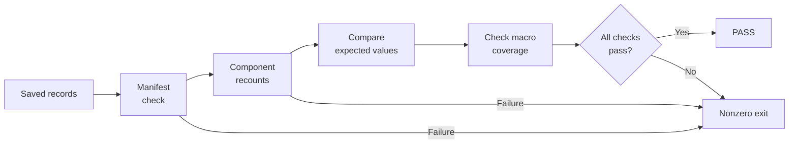

# Architecture

Author: Kuladeep Mantri.

## Recount flow

Component recounts cover headline parts 1 to 4, repair and the follow-up cohorts.

## Modules

Paths below are relative to `src/swaudit/`.

### Entry points

| Module | Purpose |
|---|---|
| `recompute_all.py` | Runs the component recounts, compares exported values and checks coverage of the manuscript macro inventory. |
| `round5.py` | Recounts white-box repaint, local SEAL diagnostic, external-reference and honest-distortion cohorts. |
| `scan.py` | Checks distribution files for privacy and integrity problems; reports locations and rule names without matching content. |

### Recount components

| Module | Paper result |
|---|---|
| `recompute.py` | Repair counts, `tab:repair` and `tab:repair-two`. |
| `round6.py` | The 114 later definitions, including final SEAL precision diagnostics. |
| `headline/part1/recompute.py` | Master acceptance and honest retention, `tab:master`. |
| `headline/part2/recompute.py` | Operating-point frontier, `tab:operating`. |
| `headline/part3/recompute.py` | Volunteer agreement and exact intervals. |
| `headline/part4/recompute.py` | Prediction, configuration and identifier macros. |

### Shared analysis

| Module | Purpose |
|---|---|
| `analysis/format_numbers.py` | Formats numbers and identifiers, using decimal half-up rounding for rounded displays. |
| `analysis/frozen_rules.py` | Applies the frozen detector rules to saved scalar records. |
| `analysis/headline.py` | Recounts headline decisions from saved scores. |
| `analysis/headline_crosscheck.py` | Independently crosschecks master counts and headline quantities against scalar records. |
| `analysis/legacy_numbers.py` | Replays audited numerical operands; these are not new measurements. |
| `analysis/statistics.py` | Computes exact binomial intervals and paired outcome summaries. |

### Support

| Module | Purpose |
|---|---|
| `paths.py` | Locates the bundled records. |
| `protocol.py` | Reads detector thresholds from `data/data/protocol.json`. |
| `inventory.py` | Extracts numerical macro usage from the manuscript input graph. |
| `outputs.py` | Invalidates generated artifacts when a recount does not complete. |

## Verification categories

The coverage report distinguishes 228 independent scalar crosschecks, 137 repair or design/context quantities, 88 follow-up scalar recounts, and 81 aggregate, configuration, publication or identifier replays. These categories describe the computation available in this distribution; a replay is not a new measurement. The report lists four specific selectors that the independent crosscheck cannot resolve, each checked by a headline component. Unexpected failures stop the recount.

| Verification method | Used macros |
|---|---:|
| Independent scalar crosscheck | 228 |
| Repair recount or design/context record | 137 |
| Follow-up scalar recount | 88 |
| Audited numerical selector or configuration replay | 30 |
| Follow-up frozen configuration replay | 25 |
| Volunteer aggregate or screening definition replay | 14 |
| Source-bound identifier or code location | 11 |
| Published comparison endpoint replay | 1 |

The legacy selector module replays audited operands rather than independently measuring their original sources. The independent crosscheck recalculates master counts and several headline quantities from scalar records; some naturalness, historical model summaries and bootstrap endpoints remain aggregate replays.

## Validation and numerical policy

`data/data/protocol.json` supplies the detector thresholds. Named rules use those values, and the independent master-context declaration must agree. The public recount does not use a second table of literal cutoffs. Configuration values describing an experiment remain explicitly classified as configuration replays.

All rounded displays use decimal half-up rounding in `analysis/format_numbers.py`, with scaling before rounding. Exact serialized values retain their original representation. For example, 12.5 rounded to zero decimal places is 13. Integrity checks raise errors under both normal Python and `python -O`.

`data/data/crosscheck-policy.json` names the source-and-path-specific exceptions and allowed aggregate-only sources. A changed selector cannot silently become a replay. `RESULT.json` includes the four exceptions and a coverage breakdown.

## Privacy scan and distribution integrity

The manifest covers only the record directory, so Git metadata, license files and CI configuration cannot change its inventory. It still rejects unexpected files inside the records. `.gitattributes` pins text to LF. The privacy scanner checks decoded JSON strings and accent-folded names with whitespace, dot, underscore or hyphen separators; reports contain file locations and rule names, never matching content.

[Repository README](../README.md) · [Reproduce](REPRODUCE.md) · [Results](RESULTS.md) · [Data](DATA.md)
